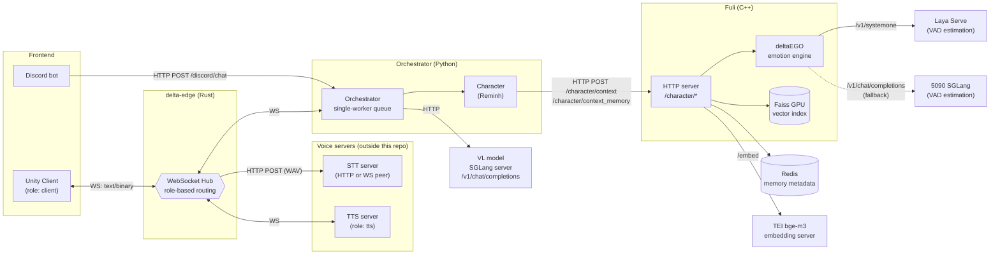
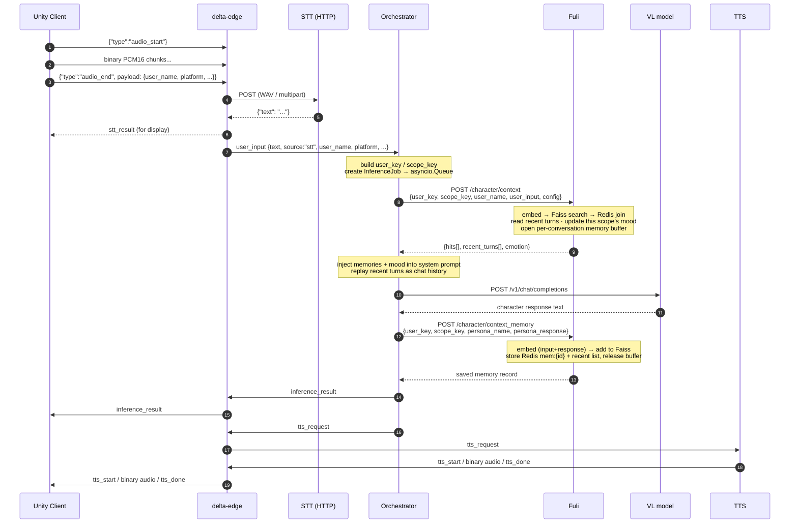
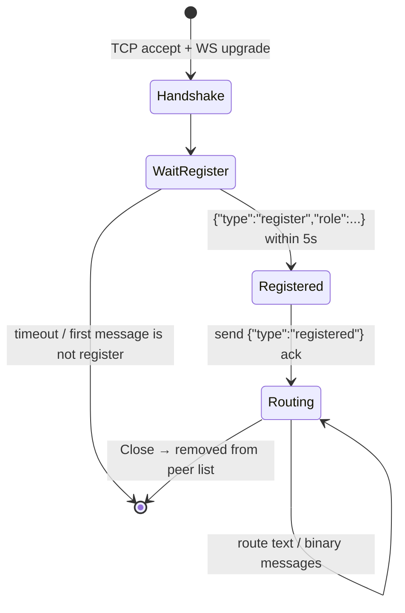
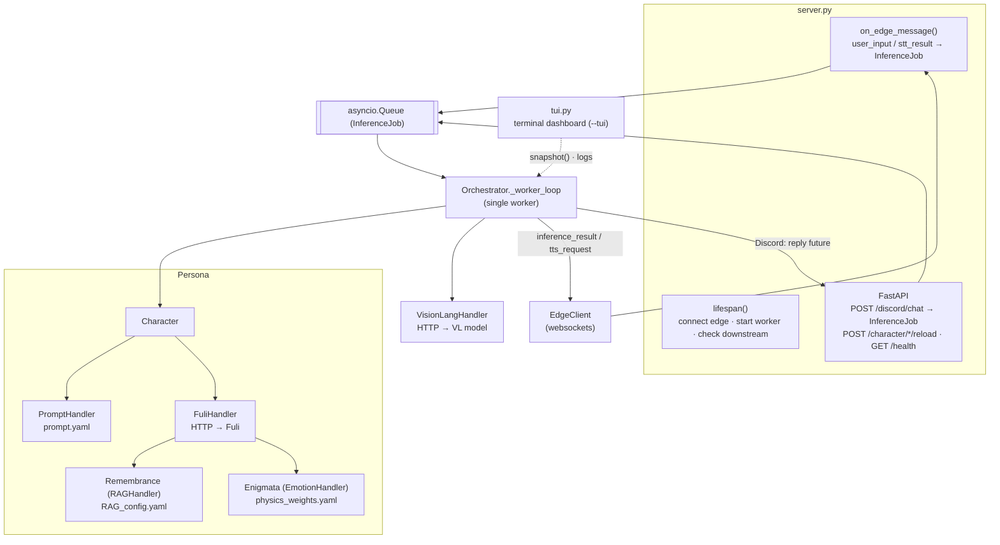
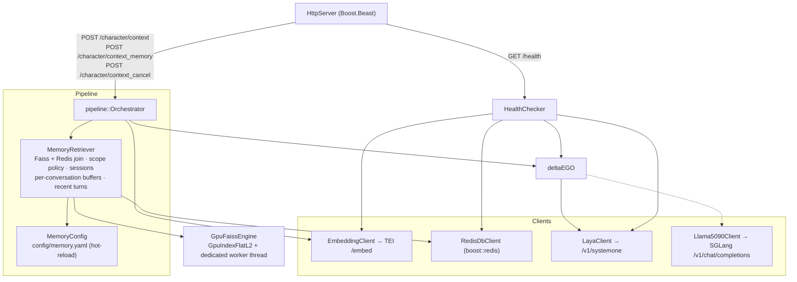
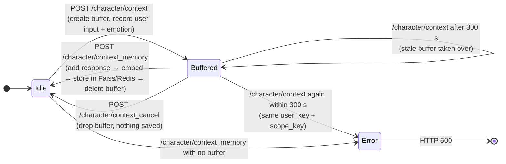
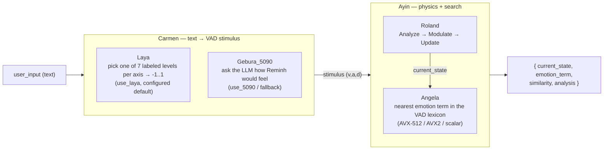
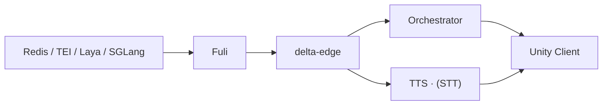
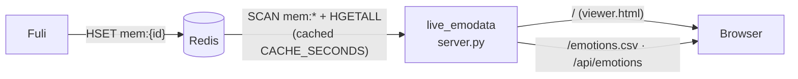

# deltaAnima

**deltaAnima** is a real-time, self-hosted backend for **Reminh**, an AI character that remembers past conversations and has a continuously evolving emotional state.

You talk to Reminh by voice (or text) through a Unity client. She recalls relevant past conversations, reacts emotionally in a way shaped by her personality, answers in character, and speaks the answer back — all running on our own GPU servers, with no cloud APIs.

https://github.com/user-attachments/assets/58ccae23-5b89-4013-8cbe-ad9e223b61b3

---

## Why we built this

Most AI chat characters are stateless: every conversation starts from zero, and their "personality" is just a paragraph in a prompt. We wanted to find out what it actually takes to build a character that **remembers you** and whose **mood carries over** from one message to the next — and to run the entire voice-to-voice loop in real time on hardware we own and operate ourselves.

That turned out to be as much a systems problem as a model problem: routing audio and messages between many services, keeping GPU-bound inference from contending, retrieving memories fast enough to stay conversational, and deploying it all across multiple machines on a segmented network.

---

## How it works (in plain terms)

Every time you say something to Reminh, one "turn" happens:

1. **Listen** — your voice is sent to a speech-to-text server and turned into text.
2. **Remember** — the text is turned into a vector and used to search Reminh's memory of past conversations with you. Her last few exchanges in the same conversation are also replayed, so she keeps track of what was just said.
3. **Feel** — Reminh's emotion engine estimates how *she* would feel hearing this, and moves her current mood accordingly. How strongly she reacts, and how quickly she calms down, depends on her personality.
4. **Think** — her memories and current mood are written into the prompt, and a language model generates her reply.
5. **Save** — the exchange (what you said + what she said + how she felt) is stored as a new memory.
6. **Speak** — the reply goes back to the Unity client as text and to a text-to-speech server, which streams her voice back.

The three services in this repository implement the "glue" and the "brain" of that loop:

| Directory | Service | Language / Runtime | Role |
|---|---|---|---|
| [`edge/`](edge/) | **delta-edge** | Rust (tokio, tungstenite) | WebSocket hub every service connects to. Role-based message routing + HTTP STT bridge |
| [`orchestrator/`](orchestrator/) | **Reminh Orchestrator** | Python (FastAPI, asyncio) | Inference job queue, persona prompt assembly, VL model calls, result delivery |
| [`fuli/`](fuli/) | **Fuli** | C++20 (Boost.Asio coroutines, Faiss GPU, Redis) | Embedding → vector search → memory storage, plus the **deltaEGO** emotion engine |

Alongside them sits one developer tool:

| Directory | Tool | Language / Runtime | Role |
|---|---|---|---|
| [`live_emodata/`](live_emodata/) | **live_emodata** | Python (stdlib HTTP server, redis-py) | Read-only viewer that reads the memories Fuli stores in Redis and plots Reminh's emotion (VAD) over time in the browser |

The speech (STT/TTS) servers, model servers, and Unity client live outside this repository.

> **Naming note:** "Orchestrator" refers to the Python service. Fuli also has an internal `pipeline::Orchestrator` class that coordinates its own request pipeline; the two are unrelated.

---

## Table of Contents

1. [Architecture](#1-architecture)
2. [Deployment](#2-deployment)
3. [Results](#3-results)
4. [Lifecycle of a Turn](#4-lifecycle-of-a-turn)
5. [delta-edge (Rust WebSocket Hub)](#5-delta-edge-rust-websocket-hub)
6. [Orchestrator (Python)](#6-orchestrator-python)
7. [Fuli (C++ Memory & Emotion Server)](#7-fuli-c-memory--emotion-server)
8. [deltaEGO Emotion Engine](#8-deltaego-emotion-engine)
9. [Build & Run](#9-build--run)
10. [Configuration Reference](#10-configuration-reference)
11. [Current Status & Known Limitations](#11-current-status--known-limitations)
12. [Team & Contributions](#12-team--contributions)
13. [Previous Version](#13-previous-version)
14. [Third-Party Data & Licenses](#14-third-party-data--licenses)

---

## 1. Architecture



**Key design points**

- **Hub-and-spoke**: the Client, Orchestrator, TTS (and optionally STT) never connect to each other directly. They all connect to `delta-edge` over WebSocket. Each connection first registers its **role**, and every message after that is routed statically by the `(sender role, message type)` pair.
- **Orchestrator ↔ Fuli is HTTP/JSON**: two calls per turn. One *before* inference to fetch memories and emotion (`/character/context`), and one *after* inference to store what the character actually said (`/character/context_memory`).
- **Heavy work lives in Fuli**: embedding, vector search, and emotion computation all happen on the C++ side. The Python side is a thin, stateless layer that only keeps per-character policy (RAG settings, OCEAN personality values) in YAML and sends it along with each request.
- **GPU-bound work is serialized on purpose**: the VL model runs as a single instance on a single GPU, so the Orchestrator processes jobs with one worker to avoid contention and out-of-memory failures. Unity (over the edge) and Discord (over HTTP) share that one queue.
- **Who and where, not just who**: every turn carries a `user_key` (who is talking) and a `scope_key` (where: a Unity scene, a Discord channel, a DM). Fuli uses the pair to separate memories, sessions, and moods, so Reminh can feel differently in different channels and never leaks a DM into a group chat (see [6.3](#63-identity-user_key-and-scope_key)).

---

## 2. Deployment

<!-- TODO (Justin): verify GPU/host placement matches the current setup. -->

deltaAnima runs on a small self-hosted cluster rather than a single machine:

- **Three VMware vSphere (ESXi) hosts**, with GPUs passed through 1:1 to dedicated VMs (RTX 5090, RTX 3090s, RTX 3050).
- **Network segmentation with a FortiGate firewall.** `delta-edge` is the only component exposed to clients and sits in an isolated DMZ; every other service runs on internal networks.
- **Model servers run as plain Docker containers** on GPU passthrough VMs. The workloads have fixed roles rather than elastic scaling needs, so a Kubernetes layer would add overhead without benefit.
- **Network-aware placement.** The hosts are interconnected at 1 Gbps, so the entire retrieval path — embedding, vector search, emotion scoring, Redis, and prompt assembly — is placed on a **single host**. A request crosses the host boundary only once in each direction instead of bouncing between machines for every sub-step.

---

## 3. Results

| Metric | Before | After | What changed |
|---|---|---|---|
| TTS real-time factor (RTX 3090) | > 1.0 (slower than real time) | ≈ 0.4 | Moved the node from Windows 11 + WSL2 to native Ubuntu 24.04; WSL2's WDDM overhead was the root cause (~3× throughput) |
| Emotion (VAD) inference latency | ~170 ms (VL model on RTX 5090) | ~30 ms (OpenJEV on RTX 3090, experimental) | Early port of emotion scoring to a small dedicated classifier. Fast, but output quality was not stable enough; this path has since been replaced by Laya (see [8.1](#81-carmen--extracting-a-stimulus-from-text)) |

### End-to-end voice latency

Measured from the end of the user's speech, as logged by the Unity client for a single representative voice turn:

| Stage | Time | Cumulative |
|---|---|---|
| Speech-to-text result | 273 ms | 273 ms |
| Memory retrieval + emotion + response generation + memory save | ~814 ms | 1,087 ms |
| First TTS audio chunk | ~509 ms | **1,596 ms** |

The character starts speaking about **1.6 seconds** after the user stops talking. TTS then streamed 13.4 seconds of audio in about 6 seconds (RTF ≈ 0.45).

> This is a single measurement. A larger benchmark (median / p90 over many turns) and a per-stage breakdown inside the Orchestrator are planned once the Unity client is more stable.

---

## 4. Lifecycle of a Turn

The full sequence from the moment the user speaks until the turn completes (HTTP STT mode).



> For text input, the Client skips steps 1–7 and sends a `user_input` message directly (see [6.4](#64-messages-and-http-api)). Discord turns skip the edge entirely: the bot calls `POST /discord/chat` and gets the reply in the HTTP response.

---

## 5. delta-edge (Rust WebSocket Hub)

Source: [`edge/src/`](edge/src/) — `main.rs` (accept loop), `hub.rs` (connections & routing), `routing.rs` (routing table), `stt.rs` (HTTP STT client)

### 5.1 Connection lifecycle



- Peers are stored in a `DashMap` of `role → Vec<PeerHandle>`, so **multiple connections can share a role** (e.g. several Unity clients), and a message addressed to a role is **fanned out to every peer** with that role.
- Each connection has its own `mpsc` channel and send task, so one slow peer never blocks the others.

### 5.2 Roles and the routing table

| role | Who |
|---|---|
| `client` | Unity frontend |
| `stt` | WebSocket STT server (not needed in HTTP STT mode) |
| `orchestrator` | The Python server in this repo |
| `tts` | TTS server |

**Text messages** (`resolve_text` in `routing.rs`)

| Sender role | `type` | → Receiver role |
|---|---|---|
| `client` | `user_input` | `orchestrator` |
| `client` | `audio_input` | `stt` |
| `stt` | `stt_result` | `orchestrator` |
| `orchestrator` | `inference_result` | `client` |
| `orchestrator` | `tts_request` | `tts` |
| `tts` | `tts_start`, `tts_done` | `client` |

**Binary messages** (`resolve_binary`): `tts → client` (audio chunks), `client → stt` (raw audio)

If a message carries `"to": "<role>"`, the table is bypassed and the message is **routed explicitly**.

### 5.3 Message envelope

```jsonc
// Sending (peer → hub)
{ "type": "user_input", "to": null, "payload": { "text": "hello" } }

// Receiving (hub → peer) — the hub fills in "from"
{ "type": "user_input", "from": "client", "payload": { "text": "hello" } }
```

The hub never inspects `payload`; it forwards it as-is.

### 5.4 HTTP STT mode

When the `STT_URL` environment variable is set, audio from a `client` is **buffered by the hub itself** instead of being streamed to an STT peer.

1. `audio_start` → clear the per-connection buffer
2. Binary frames (PCM16 LE mono) → appended to the buffer (capped at `STT_MAX_SECONDS`; anything beyond is dropped)
3. `audio_end` → wrap the buffer in a WAV header and POST it to `STT_URL` (in a separate task). The client puts its identity (`user_name`, `platform`, `platform_user_id`, `scope_id`) in this message's `payload`.
4. Extract the transcript from the response (`{"text"}`, `{"transcript"}`, `{"result"}`, or a plain string are all accepted)
5. Send `stt_result` back to the requesting client and `user_input {source:"stt"}` to the Orchestrator, with the identity fields from `audio_end` copied in. On failure, the client gets an `error` message.

> The Orchestrator rejects any `user_input` without a `user_name`, so a voice client that omits its identity on `audio_end` gets an error instead of a reply.

Without `STT_URL`, audio is routed to a WebSocket `stt` peer as before.

---

## 6. Orchestrator (Python)

Source: [`orchestrator/`](orchestrator/)



### 6.1 Modules

| File | Description |
|---|---|
| [`server.py`](orchestrator/server.py) | Entry point. Initializes handlers, connects to the edge, turns edge messages and Discord HTTP requests into `InferenceJob`s, hosts the FastAPI app |
| [`orchestrator.py`](orchestrator/orchestrator.py) | Job queue with a **single worker**. The VL model is one instance on one GPU, so jobs run strictly one at a time to avoid contention and OOM. Edge jobs are answered over the edge; Discord jobs are answered through a future the HTTP handler is awaiting |
| [`edge_client.py`](orchestrator/edge_client.py) | WebSocket client for the edge hub (`register` → listen loop, `send_routed`). Reconnects with backoff and re-registers when the hub drops the link |
| [`VisionLangHandler.py`](orchestrator/VisionLangHandler.py) | Client for an SGLang server (OpenAI-compatible API). Checks the model is loaded and can read images via `/get_model_info`, runs inference via `/v1/chat/completions` with optional thinking mode, replayed history, and one image per turn |
| [`tui.py`](orchestrator/tui.py) | Optional terminal dashboard (`python server.py --tui`): queue and in-flight job, downstream server status, live log, reload hotkeys, and a verbose view (`v` key / `-v`) with prompts, Fuli hits, token usage, and latency |
| [`config.py`](orchestrator/config.py) / [`config.yaml`](orchestrator/config.yaml) | Loader for every environment-specific value (IPs, ports, model). Runs a TCP-level liveness sweep at startup (`test_servers`) |
| [`Persona/Character.py`](orchestrator/Persona/Character.py) | One character = prompt + RAG policy + emotion policy + VL handler. Picks the prompt template by platform and turns Fuli's recent turns into chat history |
| [`Persona/FuliHandler.py`](orchestrator/Persona/FuliHandler.py) | HTTP transport to Fuli. Responses are validated against Pydantic schemas (`RAG_schemas.py`) |
| [`Persona/PromptHandler.py`](orchestrator/Persona/PromptHandler.py) | Prompt templates for Unity/TTS, Discord text, and VAD inference |
| [`Persona/RAGHandler.py`](orchestrator/Persona/RAGHandler.py) | Turns the character's RAG policy into a `RAGQueryOrder`; flattens hits into `"<name>: <line>"` form |
| [`Persona/EmotionHandler.py`](orchestrator/Persona/EmotionHandler.py) | Loads OCEAN/physics weights and the emotion backend flags (`use_laya`, `use_5090`, `fallback_to_5090`). Sent with every request, so a reload takes effect on the next turn |
| [`Server/Pydantic_frame.py`](orchestrator/Server/Pydantic_frame.py) | Pydantic models for HTTP requests/responses |

### 6.2 Adding a character

`Character` finds its config in `Persona/Config/<character name>/` automatically. Adding a character only means adding a folder.

```
Persona/Config/
├── Common/
│   └── VAD_inference_prompt.yaml   # VAD inference prompt shared by all characters
└── Reminh/
    ├── prompt.yaml                 # identity, appearance, guidelines, per-medium (Unity/Discord) rules and examples
    ├── RAG_config.yaml             # retrieval policy (top_k, thresholds, domain, fusion weights, ...)
    └── physics_weights.yaml        # OCEAN personality + emotion physics weights
```

`Character.__reload__(data)` re-reads all three configs from disk at runtime, or hot-swaps them in memory with a dict of the same shape (a shape mismatch raises). The prompt and emotion configs can also be reloaded over HTTP or from the TUI (see 6.4).

### 6.3 Identity: `user_key` and `scope_key`

Every job carries three names for the person talking. Fuli keys memories, sessions, per-turn buffers, and moods by the first two; the display name is only shown to the model.

| Field | Built from | Example | Used for |
|---|---|---|---|
| `user_key` | `"<platform>:<platform_user_id>"` | `discord:1234…` | Stable identity. Survives display-name changes |
| `scope_key` | `"<platform>:<scope_id>"` (Unity) / `discord:<guild>:<channel>` / `discord:dm:<channel>` | `unity:default` | Where the conversation happens. Bounds retrieval, sessions, the recent-turn list, and the mood |
| `user_name` | client-supplied | `Justin` | Display name in prompts and saved memories. **Required**; requests without it are rejected |

- How far a memory search reaches is set per character by `memory_config.scope` in `RAG_config.yaml`: `user_in_scope` (default: this user, this scope), `scope` (everyone in this scope, for group chats), or `user` (this user, any scope). **DM scopes are never visible from any other scope**, whatever the policy.
- Edge clients that send only `user_name` still work: they fall back to `user_key = "legacy:<user_name>"`, so two people with the same name on different platforms would share memories until the client sends real ids.

### 6.4 Messages and HTTP API

**Edge messages**

```jsonc
// client → orchestrator (text input; voice input carries the same fields on audio_end)
{ "type": "user_input", "payload": {
    "text": "…", "user_name": "Justin",
    "platform": "unity", "platform_user_id": "…", "scope_id": "living_room",  // optional, see 6.3
    "image_base64": null } }

// orchestrator → client
{ "type": "inference_result", "payload": {
    "request_id": "…", "status": "success", "output_text": "…", "error": null,
    "memory": { /* memory record saved by Fuli (without query and user_id) */ } } }

// orchestrator → tts (only on success)
{ "type": "tts_request", "payload": { "request_id": "…", "text": "…", "speaker": "reminh" } }
```

**HTTP endpoints**

| Method · Path | Purpose |
|---|---|
| `POST /discord/chat` | Discord bot entry point. Body: `user_id`, `user_name`, `guild_id`, `channel_id`, `is_dm`, `message_content`, `attachments`. Queues the turn on the same worker as Unity and returns `{request_id, status, output_text, error, emotion_tag}`. Times out after 180 s (the turn still runs and is still saved) |
| `POST /character/emotion/reload` | Re-read `physics_weights.yaml` without a restart |
| `POST /character/prompt/reload` | Re-read `prompt.yaml` and the shared VAD prompt without a restart |
| `GET /health` | `{status, queue_size}` |

---

## 7. Fuli (C++ Memory & Emotion Server)

Source: [`fuli/`](fuli/) · Build target: `orchestrator_server`

Fuli runs on a **single-threaded `io_context` with C++20 coroutines**. Blocking work (Faiss GPU calls) is pushed to a dedicated worker thread, and the resulting `std::future` is awaited through `util::AwaitFuture` so the event loop never blocks.



### 7.1 HTTP endpoints

| Method · Path | Request | Response |
|---|---|---|
| `POST /character/context` | `FuliContextRequest` — `user_key`, `scope_key`, `user_name`, `user_input`, `context`, `config.rag_policy`, `config.emotion_policy` | `{ hits: [{id, score, user_input, model_response}], recent_turns: [...], emotion_json }` |
| `POST /character/context_memory` | `FuliContextSaveRequest` — `user_key`, `scope_key`, `user_name`, `persona_name`, `persona_response` | Full saved `MemoryMetadata` (JSON) |
| `POST /character/context_cancel` | `FuliContextCancelRequest` — `user_key`, `scope_key`, `user_name` | `{ cancelled: bool }` — drops an open buffer without saving (idempotent) |
| `GET /health` | – | `{ status: "ok" \| "degraded", services: {...} }` |

Example requests/responses are in [`fuli/main_orch_files/`](fuli/main_orch_files/) for reference only (not used by the main code).

### 7.2 The `/character/context` pipeline

1. **Acquire a memory buffer** — keyed by the conversation `(user_key, scope_key)`; `user_key` is hashed with MurmurHash3 (128-bit). A buffer left unsaved for more than `kStaleBufferSeconds` (300 s) is taken over by the next request.
2. **Resolve the session ID** — `MemoryRetriever` owns one session UUID per conversation; the first request for a conversation mints it.
3. **Embed + recent turns** — the input is embedded with TEI (bge-m3, 1024 dims) unless `rag_policy.dense_vector` is given; in parallel, the conversation's latest turns are read from Redis (count set in `config/memory.yaml`).
4. **First-pass retrieval** — Faiss is oversampled at `top_k × 5`, candidates are joined with Redis metadata and filtered by session, by the user/scope policy (6.3), and by `importance_threshold`.
5. **Emotion branch** — `deltaEGO::sephirothic_tree(user_input, scope_key, emotion_policy)` updates **this scope's** mood, using the backend and OCEAN weights from the request's `emotion_policy` (see [Section 8](#8-deltaego-emotion-engine)).
6. **Assemble** — memories already present in `recent_turns` are dropped from `hits`; the response is built and this turn's user input, emotion snapshot, and original request are recorded in the buffer.

### 7.3 Two-phase turn protocol (memory buffer)

A memory is stored as a **pair of user input and character response**, so every turn must be completed with two calls.



- On the Python side, `Orchestrator._process` always calls `save_turn()` exactly once after a successful VL inference.
- The buffer is **always deleted** after a save, even if the Store step fails, so the next turn is never blocked.
- Because buffers are per conversation, the same user can have turns open in two different scopes (e.g. two Discord channels) at once.

### 7.4 Storage

| Store | Contents | Notes |
|---|---|---|
| **Faiss** (`GpuIndexFlatL2`) | Embedding of `(user_input + model_response)`, ID = ID allocated by Redis | Saved to `data/memory_index.faiss` / `.ids`. Autosaved every 5 minutes and on SIGINT/SIGTERM |
| **Redis** | `mem:{id}` hash — conversation content, user/persona, `user_key`/`scope_key`, emotion snapshot, session, timestamp, original request | IDs come from the `next_mem_id` counter (`INCR`). Nested fields are flattened with dot notation, e.g. `memory.content.user_input` |
| **Redis** | `recent:scope:{scope_key}` (or `recent:user:{user_key}` without a scope) list — the conversation's latest turns, newest first | Trimmed to `max_stored`, expires after `ttl_seconds` of inactivity (both in `config/memory.yaml`) |

> If no saved index exists, Fuli **seeds 200 random test vectors** (`SeedTestVectors`) so the pipeline can be verified end to end. Remove this before real use.

---

## 8. deltaEGO Emotion Engine

Source: [`fuli/src/deltaEGO/`](fuli/src/deltaEGO/)

deltaEGO represents the character's emotion as **a point in 3D VAD (Valence · Arousal · Dominance) space** and moves it physically in response to stimuli, in a way shaped by the character's personality (OCEAN).

deltaEGO keeps **one mood per `scope_key`**: each Discord channel, DM, and Unity scene has its own VAD state and history, so an argument in one channel doesn't sour Reminh's mood in another. A mood untouched for `kMoodIdleSeconds` (24 h) is dropped, and the next message in that scope starts again from the resting state.



### 8.1 Carmen — extracting a stimulus from text

Both backends estimate **the character's reaction**, not the speaker's emotion: the question is always how *Reminh herself* would feel on hearing the message. Which one runs is chosen per request by the `emotion_policy` flags the Orchestrator sends (`emotion_inference` in `config.yaml`).

- **Laya path (configured default)**: sends the message to Laya Serve (`POST /v1/systemone`) in a single request with one question per axis, each offering seven labeled levels from "very negative" to "very positive", each anchored by examples ("neutral (ordinary question, greeting, small talk)"). Laya's expected level index is mapped onto -1..1. It answers in tens of milliseconds on a GPU. A bearer token is read from the `LAYA_API_KEY` environment variable if Laya requires one.
- **5090 path (fallback)**: asks the SGLang server on the 5090 GPU machine, with a persona prompt (same idea as [`VAD_inference_prompt.yaml`](orchestrator/Persona/Config/Common/VAD_inference_prompt.yaml)), for VAD JSON. SGLang's schema-constrained output guarantees the reply parses. Used when `use_5090` is set, or when Laya fails and `fallback_to_5090` is on.


### 8.2 Roland — personality-driven emotion physics

Each stimulus goes through three steps: `Analyze → Modulate → Update`.

**① Base physics coefficients from personality** (`updatePhysicsWeights`)

| Coefficient | Formula | Meaning |
|---|---|---|
| Positive sensitivity | `1 + E·w₁ + O·w₂` | Higher extraversion/openness → stronger reaction to positive stimuli |
| Negative sensitivity | `1 + N·w₃` | Higher neuroticism → stronger reaction to negative stimuli |
| Emotion resistance | `clamp(base + C·w₄ − O·w₅)` | Higher conscientiousness → emotions shift less easily |
| Decay rate | `clamp(base + C·w₆ − N·w₇)` | How fast the state returns to baseline |

**② Modulating coefficients from accumulated state** (`modulatePhysics`)

- Cumulative **stress ratio** above threshold → negative sensitivity increases (becomes touchier)
- **Affective lability** (sigmoid) above threshold → resistance decreases (mood swings)
- Cumulative **reward ratio** above threshold → decay rate increases (recovers faster)

**③ State update** (`updateEmotion`)

```
target  = stimulus × (V ≥ 0 ? positive sensitivity : negative sensitivity)   // D unchanged
current = lerp(target, current, resistance)                                 // move toward stimulus
radius  = (|A| + |V|) / 2                                                   // emotional intensity
current = lerp(current, default_state, decay rate)                          // pulled back to baseline
current = clamp(current, -1, 1)
```

### 8.3 Angela — mapping to an emotion term

Finds the emotion word closest to the updated VAD point in a VAD lexicon (entries look like `abandonment: V -0.744, A -0.14, D -0.596`). Coordinates are quantized into an Int16 tensor, and the CPU is detected at runtime to choose an **AVX-512 → AVX2 → scalar** distance kernel. The resulting `emotion_term` becomes `Reminh's Current Mood` in the Orchestrator's prompt.

> The lexicon file (`fuli/include/VAD_DB/VAD.json`) is **not included** in this repository for licensing reasons. See [Third-Party Data & Licenses](#14-third-party-data--licenses).

### 8.4 Example personality config

```yaml
# orchestrator/Persona/Config/Reminh/physics_weights.yaml
OCEAN:
  Openness: 0.6
  Conscientiousness: 0.7
  Extraversion: 0.4
  Agreeableness: 0.6
  Neuroticism: 0.3
```

> The Orchestrator sends these weights with every request (`emotion_policy`), and deltaEGO applies them to that turn, so editing `physics_weights.yaml` and calling `POST /character/emotion/reload` changes Reminh's temperament on the next message. `fuli/config/deltaEGO_default.yaml` is only the fallback for requests that carry no policy.

---

## 9. Build & Run

> All three services target **Linux** (`server.py` uses the `pwd` module; `run_server.sh` uses `taskset`/`setsid`).

> **Reproducing the full pipeline requires multiple GPUs** (a VL model server, an embedding server, and optionally STT/TTS). Each service can be built and started on its own, and Fuli can be built without a GPU using the mock Faiss engine (`-DENABLE_GPU=OFF`), but it still expects Redis and a TEI embedding server to be reachable.

### 9.1 Prerequisites (external services)

| Service | Purpose | Used by |
|---|---|---|
| Redis | Memory metadata and recent-turn lists | Fuli |
| [TEI](https://github.com/huggingface/text-embeddings-inference) + `bge-m3` | 1024-dim embeddings (`/embed`) | Fuli |
| Laya Serve | VAD estimation (configured default) | Fuli (deltaEGO) |
| [SGLang](https://github.com/sgl-project/sglang) server (5090) | VAD estimation (fallback) | Fuli (deltaEGO) |
| SGLang server with a vision-language model | Character response generation | Orchestrator |
| STT server | Speech recognition (HTTP or WS) | delta-edge |
| TTS server | Speech synthesis (connects to the edge as role `tts`) | delta-edge |
| NRC-VAD lexicon | Emotion term lookup (`VAD.json`, not included) | Fuli (deltaEGO) |

### 9.2 Recommended startup order



The Orchestrator connects to the edge on startup, so **the edge must be up first**. Downstream servers being down does not block the Orchestrator from booting; it only logs them.

### 9.3 Fuli

Requirements: CMake ≥ 3.22, a C++20 compiler, Boost (system), OpenMP, yaml-cpp, Protobuf, gRPC, and for GPU builds CUDA Toolkit + Faiss (GPU). `asio-grpc`, `boost_redis`, and `concurrentqueue` are fetched automatically via CMake `FetchContent`.

```bash
cd fuli
cmake -S . -B build -DENABLE_GPU=ON      # without a GPU: -DENABLE_GPU=OFF (mock Faiss engine)
cmake --build build -j

./run_server.sh start                    # runs in the background pinned to CPUs 1-12 (override with CPU_LIST)
./run_server.sh status | logs [n] | restart | stop
```

Config paths (`config/`, `include/VAD_DB/`, `data/`) are **relative to the launch directory**, so the binary must be started from `fuli/` (`run_server.sh` does the `cd` for you). `stop` sends SIGTERM so the index is saved before exit.

Before starting, place the VAD lexicon at `fuli/include/VAD_DB/VAD.json` (see [Section 14](#14-third-party-data--licenses)).

### 9.4 delta-edge

Requirements: Rust (edition 2024 → rustc 1.85 or later)

```bash
cd edge
# optionally create a .env (see 10.1); it is loaded automatically via dotenv
cargo run --release
```

### 9.5 Orchestrator

Requirements: Python 3.10+

```bash
cd orchestrator
pip install fastapi uvicorn websockets requests pydantic pyyaml python-dotenv
python server.py

# optional: terminal dashboard
pip install -r requirements-tui.txt
python server.py --tui        # add -v to start with the verbose view on
```

Every request needs a `user_name` (see [6.3](#63-identity-user_key-and-scope_key)), so clients must send one before they get replies.

### 9.6 live_emodata (emotion data viewer)

An optional tool for inspecting how Reminh's emotional state evolves. It is not part of the request path: it only **reads** the `mem:*` hashes Fuli writes to Redis (see [7.4 Storage](#7-fuli-c-memory--emotion-server)) and serves them as a live web page, so it can be started or stopped at any time.



Requirements: Python 3.12, `redis`

```bash
cd live_emodata
pip install redis
python server.py            # http://127.0.0.1:<SERVER_PORT>
```

- The viewer plots V/A/D, radius, reward/stress, and the matched emotion term for every saved turn, and links each turn to its conversation text.
- If `VAD.json` is placed in `live_emodata/`, the full lexicon is also drawn as a backdrop in VAD space (optional; see [Section 14](#14-third-party-data--licenses)).
- Redis connection, bind address, and cache interval come from `live_emodata/.env` or CLI flags. See [`live_emodata/README.md`](live_emodata/README.md) for the full option table.
- **Privacy:** user/session IDs are pseudonymized with HMAC (`EXPORT_SALT`), but user names and message text are shown as-is. The server listens on `127.0.0.1` by default; do not expose it without access control.

---

## 10. Configuration Reference

> ⚠️ Every address in the committed config is a `127.0.0.1:8080` **placeholder**. Running several services on one machine will cause port conflicts, so update them for your deployment.

### 10.1 delta-edge environment variables (`edge/.env`)

| Variable | Default | Description |
|---|---|---|
| `EDGE_BIND_ADDR` | `127.0.0.1:8080` | Hub bind address |
| `RUST_LOG` | `delta_edge=debug,info` | Log filter |
| `STT_URL` | (unset) | Enables HTTP STT mode when set, e.g. `http://host:port/transcribe` |
| `STT_FORMAT` | `multipart` | `multipart` \| `wav` \| `pcm` |
| `STT_FILE_FIELD` | `file` | Multipart file field name |
| `STT_TEXT_FIELD` | auto (`text`/`transcript`/`result`) | JSON field holding the transcript |
| `STT_SAMPLE_RATE` | `16000` | Sample rate of incoming PCM |
| `STT_TIMEOUT_SECS` | `30` | STT request timeout |
| `STT_MAX_SECONDS` | `60` | Max buffered audio per utterance (seconds) |

### 10.2 Orchestrator (`orchestrator/config.yaml`)

| Key | Description |
|---|---|
| `server.host`, `server.port` | FastAPI bind address |
| `edge.url` | Edge hub WS URL (the `EDGE_SERVER_URL` env var takes precedence) |
| `edge.role` | Role to register as (`orchestrator`) |
| `servers.*_server_ip` | `host:port` of each microservice. Leave blank to skip it in the liveness sweep |
| `vl_model.address`, `vl_model.port` | SGLang server address |
| `vl_model.alias` | Must match SGLang's `--served-model-name` |
| `vl_model.model_full` | Matched against the server's `model_path` to confirm the right model is loaded |
| `vl_model.temperature`, `max_token`, `top_p` | Sampling settings (`max_token` covers thinking + answer) |
| `vl_model.enable_thinking` | Thinking mode on/off; remove the key to use the server default. Off keeps voice replies fast |
| `vl_model.timeout` | Seconds to wait for one completion |
| `emotion_inference.backend` | `laya` \| `5090` |
| `emotion_inference.fallback_to_5090` | Retry on 5090 if Laya fails |

- To use a different config file: `ORCHESTRATOR_CONFIG=/path/to/config.yaml`
- Secrets such as API keys belong in `.env`, not `config.yaml` (`.env` is gitignored).

### 10.3 Fuli (`fuli/include/config/constants.hpp`)

At the MVP stage these are **compile-time constants**; changing them requires a rebuild.

| Constant | Description |
|---|---|
| `kListenPort` | Fuli HTTP port |
| `kEmbeddingHost/Port` | TEI address |
| `kRedisHost/Port` | Redis address |
| `kLlama5090Host/Port` | SGLang address for fallback VAD estimation |
| `kLayaHost/Port` | Laya Serve address |
| `kEmbeddingDim` | Embedding dimension (bge-m3 = 1024; must match the model) |
| `kStaleBufferSeconds` | How long an unsaved turn buffer blocks its conversation before it can be taken over (300 s) |
| `kMoodIdleSeconds` | How long an idle scope keeps its mood before resetting (24 h) |
| `kFaissIndexPath` | Index save path (`data/memory_index`) |
| `kAutosaveIntervalSeconds` | Autosave interval (300 s) |

Environment variable: `LAYA_API_KEY` — bearer token for Laya, if Laya was started with one.

### 10.4 Fuli memory settings (`fuli/config/memory.yaml`)

Re-read whenever the file changes on disk; no restart or rebuild needed.

| Key | Default | Description |
|---|---|---|
| `RecentTurns.count` | `10` | How many recent turns `/character/context` returns (0 disables the feature) |
| `RecentTurns.max_stored` | `50` | How many turns Redis keeps per conversation; `count` is clamped to this |
| `RecentTurns.ttl_seconds` | `604800` | A conversation idle this long has its recent list expired (7 days) |

---

## 11. Current Status & Known Limitations

This repository is an MVP under active development. The following gaps are called out in code comments.

**Fuli**
- Of the RAG policy, only `top_k`, `scope`, session, and `importance_threshold` are applied. Knowledge-base search, hybrid (sparse+dense) fusion, graph traversal, time decay, rerank, `min_score_threshold`, and chunk expansion are parsed but ignored.
- Laya's VAD wording compresses strong positive messages (e.g. "I love you" scores about +0.33 valence where the 5090 path gives +0.80), and was tuned against only 22 messages.
- Session IDs, turn buffers, and per-scope moods live **in process memory only** and are lost on restart. Memories and recent-turn lists are in Faiss/Redis and survive.
- Random test vectors are seeded when no saved index exists.
- The `io_context` is single-threaded. `proto/search_service.proto` (gRPC) is compiled into the build but not yet exposed as a service.

**Orchestrator**
- The active character is hardcoded to `Reminh`.
- One image per turn (Discord uses only the first attachment).
- Clients that send only `user_name` fall back to a `legacy:` identity (see 6.3).
- The `speaker` in `tts_request` is hardcoded to `"reminh"`.

**delta-edge**
- There is no authentication. Any connection can register as any role, so only run it on a trusted internal network.

**Planned**
- Re-tune Laya's VAD wording on a larger message set so its estimates match the 5090 path more closely.
- Stream LLM output to TTS sentence-by-sentence to reduce time to first audio.
- Hybrid search (sparse + dense) with RRF fusion and a reranker in Fuli ("RAG 2.0").
- Idle power saving: sleep model servers when unused and cold-start them on demand from the client.
- Larger latency benchmark (median / p90) with a per-stage breakdown once the Unity client is stable.

---

## 12. Team & Contributions

<!-- TODO (Justin): check names, spelling, and roles with each member before publishing. -->

deltaAnima is built by a five-person team.

| Member | Role |
|---|---|
| **Justin (JunHyeok Choi)** | Project lead and lead systems engineer. Overall architecture; delta-edge, Orchestrator, Fuli, and the deltaEGO emotion engine |
| **Jay** | TTS model training and server; ESXi / FortiGate network design / OpenJEV emotion classifier port in Fuli |
| **Mark** | Speech-to-text (STT) |
| **WonMin** | 3D character art |
| **HyoRim** | 2D concept art |

---

## 13. Previous Version

The first prototype (docs, edge, orchestrator, and an earlier Python-wrapped deltaEGO) is preserved on the [`legacy-v1`](../../tree/legacy-v1) branch.

---

## 14. Third-Party Data & Licenses

- **NRC-VAD Lexicon** — deltaEGO's emotion-term lookup uses the NRC Valence, Arousal, and Dominance Lexicon. Its license does not permit redistribution, so `VAD.json` is **not included** in this repository. To run deltaEGO, obtain the lexicon from its authors under their terms, convert it to the expected JSON format, and place it at `fuli/include/VAD_DB/VAD.json`. The live_emodata viewer can optionally use the same file (copy it into `live_emodata/`).
  <!-- TODO (Justin): link the conversion script if it is included, and describe what happens when the file is missing. -->
- **bge-m3**, **Faiss**, **SGLang**, **TEI**, and other dependencies are used under their respective licenses.
